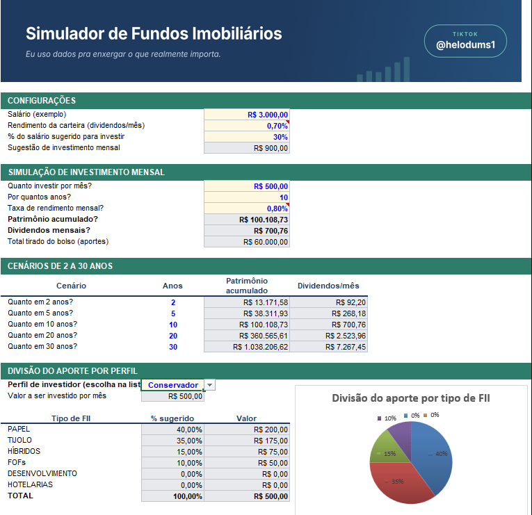
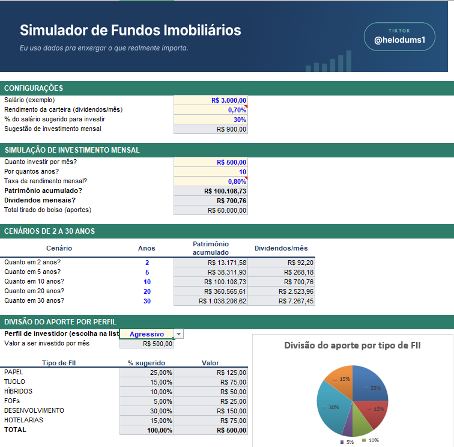

# Simulador de Fundos Imobiliários (Excel)

Ferramenta em Excel que simula investimentos em fundos imobiliários (FIIs): do aporte mensal ao patrimônio acumulado e aos dividendos que ele rende, com a divisão do aporte por perfil de investidor.

> Todos os valores do arquivo (salário, aporte, taxas e percentuais por perfil) são **exemplos didáticos**, não recomendação de investimento.

Arquivo: [`simulador-fii Heloize.xlsx`](simulador-fii%20Heloize.xlsx) — aba **Simulador** (a ferramenta) e aba **Apoio** (tabela de perfis).

## Perguntas que a ferramenta responde

| Pergunta | Onde aparece (aba Simulador) |
|---|---|
| Quanto investir por mês? | `D12` (a sugestão de 30% do salário, em `D9`, serve de referência) |
| Por quantos anos? | `D13` |
| Qual a taxa de rendimento mensal? | `D14` |
| Quanto de patrimônio vai acumular? | `D15` |
| Quanto vai receber de dividendos por mês? | `D16` |

Além disso:
- **Cenários de 2, 5, 10, 20 e 30 anos** (`B21:E25`).
- **Divisão do aporte por perfil** (`B31:D38`) com gráfico de pizza que muda junto com o perfil escolhido em `C28`.

## Como o VF e o PROCV entram nos cálculos

**VF (valor futuro)** calcula o patrimônio com aportes mensais e juros compostos:

```
=VF(taxa_mensal; qtd_anos*12; -aporte)
```

- `taxa_mensal`: rendimento por mês;
- `qtd_anos*12`: número de períodos (meses);
- `-aporte`: o pagamento mensal entra negativo, porque é dinheiro que sai do bolso. Assim o resultado vem positivo.

Os **dividendos mensais** são `patrimônio × rendimento_carteira`.

Nos cenários, as referências são absolutas para a fórmula não se perder ao arrastar: `=VF($D$14;$C21*12;-$D$12)`.

**PROCV com chave composta** acha o percentual de cada tipo de fundo para o perfil escolhido. Na aba Apoio, a coluna A junta perfil e tipo (ex.: `Moderado-PAPEL`). No Simulador:

```
=PROCV($C$28&"-"&B32; tabela_perfis; 4; FALSO)
```

Como o PROCV só procura em uma coluna, a chave `perfil-tipo` permite buscar uma combinação de duas informações.

## Intervalos nomeados

| Nome | Célula | O que é |
|---|---|---|
| `salario` | Simulador!D6 | Salário (exemplo) |
| `rendimento_carteira` | Simulador!D7 | % do patrimônio que vira dividendo por mês |
| `pct_sugestao` | Simulador!D8 | % do salário sugerido para investir (30%) |
| `sugestao_investimento` | Simulador!D9 | Salário × % sugerido |
| `aporte` | Simulador!D12 | Aporte mensal |
| `qtd_anos` | Simulador!D13 | Prazo em anos |
| `taxa_mensal` | Simulador!D14 | Taxa de rendimento mensal |
| `patrimonio` | Simulador!D15 | Patrimônio acumulado |
| `dividendos_mensais` | Simulador!D16 | Dividendos mensais |
| `perfil_escolhido` | Simulador!C28 | Perfil selecionado na lista |
| `tabela_perfis` | Apoio!A4:D21 | Tabela chave / perfil / tipo / % usada pelo PROCV |
| `lista_perfis` | Apoio!F4:F6 | Lista que alimenta a validação de dados do perfil |

## Percentuais de cada perfil

Valores de exemplo definidos por mim para fins didáticos; cada perfil soma 100% (a aba Apoio confere isso automaticamente).

| Tipo de FII | Conservador | Moderado | Agressivo |
|---|---|---|---|
| PAPEL | 40% | 30% | 25% |
| TIJOLO | 35% | 30% | 15% |
| HÍBRIDOS | 15% | 15% | 10% |
| FOFs | 10% | 10% | 5% |
| DESENVOLVIMENTO | 0% | 10% | 30% |
| HOTELARIAS | 0% | 5% | 15% |

## O que mudei em relação à ferramenta do Expert

- **Banner de assinatura** com o nome Helo, o bordão do canal e o @ do TikTok;
- **Gráfico de pizza** com a divisão do aporte, que muda junto com o perfil;
- Percentual do salário sugerido virou **célula editável** (`pct_sugestao`), em vez de ficar fixo dentro da fórmula;
- A lista de perfis vem de um **intervalo nomeado** (`lista_perfis`), não de um texto digitado na validação;
- **Validação de dados** nos campos numéricos (valores não negativos, prazo de 1 a 50 anos, taxas em faixa razoável);
- **Conferência automática** de que o perfil soma 100% (no Simulador e na aba Apoio);
- Linha extra com o **total tirado do bolso**, para comparar com o patrimônio final;
- Percentuais por perfil, layout e cores próprios (azul = editar, cinza = calculado).

## Evidências

Mesma simulação (aporte de R$ 500, 10 anos, 0,80% ao mês) em dois perfis:

**Conservador**



**Agressivo**


